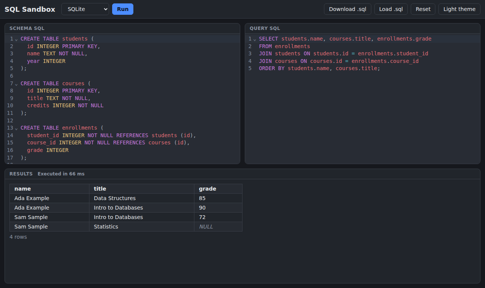

# SQL Sandbox

An open-source, account-free SQL playground for learning SQL, inspired by db-fiddle.com.
Everything runs in your browser as WebAssembly: no backend, no accounts, no telemetry.

**Live demo: [kmsoftware.net/sql-sandbox](https://kmsoftware.net/sql-sandbox/)**



## Features

- Two engines: SQLite (`sql.js`) and PostgreSQL (`@electric-sql/pglite`), loaded lazily on first use.
- Schema editor and query editor side by side (stacked on narrow screens), CodeMirror 6 with SQL highlighting.
- Every run starts from a fresh database: schema first, then the query.
- One result table per row-returning statement, "N rows affected" / "OK" for the rest, execution time, distinct `NULL`.
- Clear errors that say whether they came from the schema or the query.
- Autosave to `localStorage`; dark and light themes (follows the system by default).
- Download your session as a runnable `.sql` file and load it later.
- Run with the Run button or Ctrl/Cmd+Enter.

## How it works

- The SQL engines are compiled to WebAssembly and run inside the browser tab. Your queries never
  reach a server; the server only hosts static files.
- Each run creates a fresh in-memory database, executes the schema, then the query, and renders
  each result set. Results are inserted as text, never as HTML.
- Engines are lazy-loaded the first time you pick them, so the initial page stays small.
- Your session autosaves to `localStorage`. Downloading it produces a plain, runnable `.sql` file
  with marker comments, which the app reads back on load.

## Quick start

```sh
npm install
npm run dev      # development server
npm test         # unit tests (vitest)
npm run build    # production build in dist/
npm run preview  # serve the production build
```

## Deploying

With Docker:

```sh
docker compose up -d --build   # serves on 127.0.0.1:8110 (set SQL_SANDBOX_PORT to change)
```

Put a reverse proxy in front to expose it publicly; it can be mounted under any subpath.
Without Docker:

`npm run build` outputs a static site in `dist/` with relative asset paths, so it can be served
from any subpath (for example `https://example.com/sql-sandbox/`). Any static file host works;
make sure `.wasm` files are served as `application/wasm`.

## Session file format

A downloaded session is valid, runnable SQL. Metadata lives in marker comments:

```sql
-- @fiddle engine=sqlite
-- @fiddle section=schema
CREATE TABLE ...;
-- @fiddle section=query
SELECT ...;
```

Markers are case-insensitive. A plain `.sql` file without markers is loaded entirely into the
schema editor. An unknown engine falls back to `sqlite`. The format stays backward compatible.

## Branches and releases

- Semantic Versioning; tags are `vX.Y.Z`.
- `master` is stable and only receives merges from release branches (and hotfixes).
- `development` is experimental; feature branches (`feature/<name>`) merge into it.
- Release: branch `release/vX.Y.Z` from `development` (frozen, bug fixes only), bump the version
  and update `CHANGELOG.md`, merge into `master`, tag `vX.Y.Z`, merge back into `development`.

## License

MIT, see [LICENSE](LICENSE).
